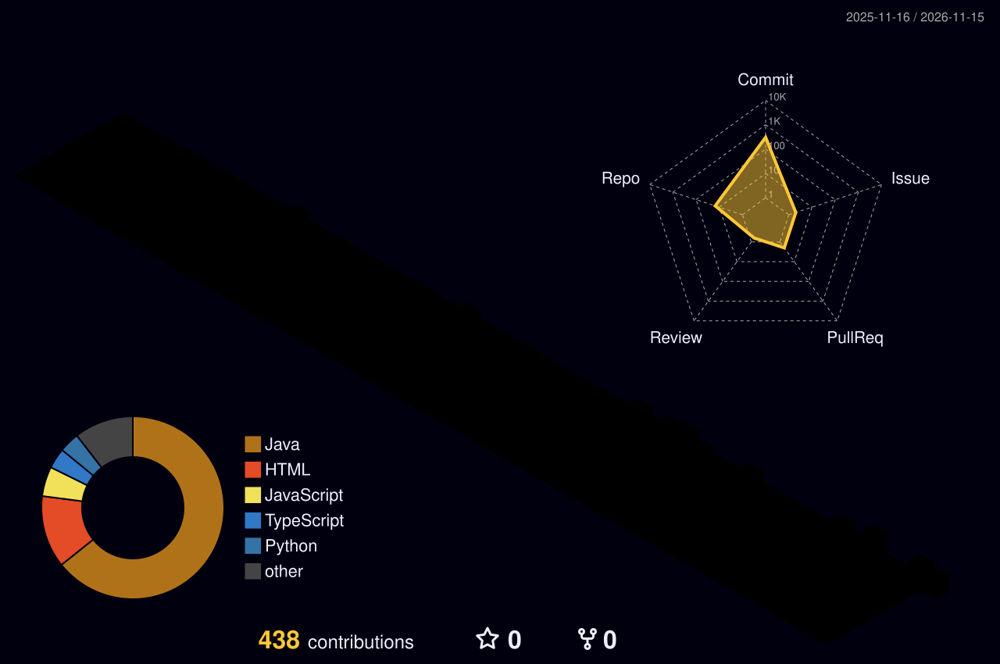

<div align="center">


[](https://git.io/typing-svg)


[](https://www.linkedin.com/in/gaurav-ghude-987b85258)
[](mailto:gaurav.ghude@vit.edu.in)
[](https://leetcode.com/u/gauravg25/)
[](https://instagram.com/gauravghude2512)

</div>

---

## About Me

<div align="center">

</div>

```python
gaurav = {
    "university": "Vidyalankar Institute of Technology, Mumbai",
    "degree":     "B.Tech – Information Technology (2024–2028)",
    "year":       "3rd year",
    "location":   "Mumbai, India",
    "focus":      ["Machine Learning", "Data Engineering", "Full Stack Development"],
    "learning":   ["System Design"],
    "interests":  ["AI/ML", "Data Warehousing", "Space Tech"],
    "hobbies":    ["Photography", "Cycling", "Astronomy"],
}
```

---

## Tech Stack

<div align="center">

### Languages


### Machine Learning & AI


### Frontend


### Backend & Frameworks


### Databases & Data Engineering


### Cloud & Tools


</div>

---

## Featured Projects

<div align="center">

| # | Project | Stack | Highlights | Links |
|---|---|---|---|---|
| 1 | **AirSense** — Air Quality Data Warehouse & ML Analytics | Next.js · FastAPI · DuckDB · PostgreSQL · XGBoost | 196.5M hourly records · 558 stations · 12-stage DuckDB ETL · XGBoost R² 0.931 | [Repo](https://github.com/GauravG2512/airsense) |
| 2 | **Squad Sync** — AI Gamer Matchmaking Backend | Python · FastAPI · SQLAlchemy 2.0 (async) · PostgreSQL | Five AI engines · JWT auth · 92.91% test coverage | [Repo](https://github.com/GauravG2512/squad-sync) |
| 3 | **POLARIS** — Lunar South-Pole Landing-Site & Rover Decision Support | React · Three.js · FastAPI · scikit-learn | Chandrayaan-2 DFSAR + OHRC + DEM · ExtraTrees regression · 3D lunar globe | Sem V project |
| 4 | **V-Reuse** — Campus Reuse Marketplace | Node.js · Express · MongoDB · Socket.IO | College-email auth · real-time chat · Cloudinary storage | [Live](https://vreuse.netlify.app) · [Repo](https://github.com/GauravG2512/vreuse-marketplace) |
| 5 | **SyncTalkies** — Real-Time Synchronized Watch Party | Next.js · TypeScript · Supabase · WebRTC | Server-authoritative playback sync · rooms up to 100 · voice/video | [Live](https://sync-talkies.vercel.app) · [Repo](https://github.com/GauravG2512/SyncTalkies-Showcase) |
| 6 | **VoyageIQ** — Multi-Agent Travel Intelligence | Python · FastAPI · LangGraph · Gemini · MongoDB Atlas | Six-agent workflow · 50,000+ record knowledge base | In development |
| 7 | **TollAI** — Automated Toll Collection | Python · YOLOv8 · EasyOCR · Flask · SQLite | Vehicle detection · plate OCR · live updates via SSE · admin panel | [Repo](https://github.com/GauravG2512/vehicle-detection-and-toll-automation) |
| 8 | **PRAVAAH** — Institutional ERP / User Management | Django · PostgreSQL · Python | Email-verified auth · RBAC · audit logging | [Repo](https://github.com/GauravG2512/pravaah_gg-L-T) |
| 9 | **Crop Disease Model** — Explainable Plant Disease Classifier | TensorFlow · MobileNetV2 · Streamlit | 38 classes · 93.36% validation accuracy · Grad-CAM | [Repo](https://github.com/GauravG2512/crop-disease-model) |
| 10 | **CineReserve (Cineverse)** — Movie Booking System | Python · Streamlit · PostgreSQL | Interactive seat map · tiered pricing · double-booking prevention | [Repo](https://github.com/GauravG2512/cineverse_dbms_miniproj) |
| 11 | **Smart Nagrik Seva** — Civic Grievance App | Spring Boot · React · MySQL | REST API · three-tier architecture | [Repo](https://github.com/GauravG2512/SNS_PROJ) |

</div>

---

## Achievements

<div align="center">

[](https://github.com/ryo-ma/github-profile-trophy)

</div>

---

## Coding Profile

<div align="center">

[](https://leetcode.com/u/gauravg25/)

[gauravg25 - LeetCode Profile](https://leetcode.com/u/gauravg25/)

</div>

---

## GitHub Stats

<div align="center">


<br/><br/>


</div>

---

## Contribution Graph

<div align="center">



</div>

---

## Contribution Snake

<div align="center">


</div>

---

## GitHub Metrics

<div align="center">


<br/>


&nbsp;&nbsp;

&nbsp;&nbsp;


<br/>


</div>

---

## Certifications

- **Python · SQL (Intermediate) · Java** — HackerRank *(Jul 2026)*
- **Credit Transfer Program in Full Stack Web Development** — L&T Skill Trainers Academy *(May 2026 · 60 hrs)*
- **Programming in Java** — NPTEL, IIT Kharagpur *(Elite · 76%)*
- **GEN AI Study Jam 2024** — Google Developers Group *(Vertex AI · Generative AI)*
- **Foundations of Prompt Engineering** — Amazon Web Services

---

## Connect With Me

<div align="center">

[](https://www.linkedin.com/in/gaurav-ghude-987b85258)
[](mailto:gaurav.ghude@vit.edu.in)
[](https://leetcode.com/u/gauravg25/)
[](https://instagram.com/gauravghude2512)

<br/>


&nbsp;&nbsp;


<br/><br/>


</div>
